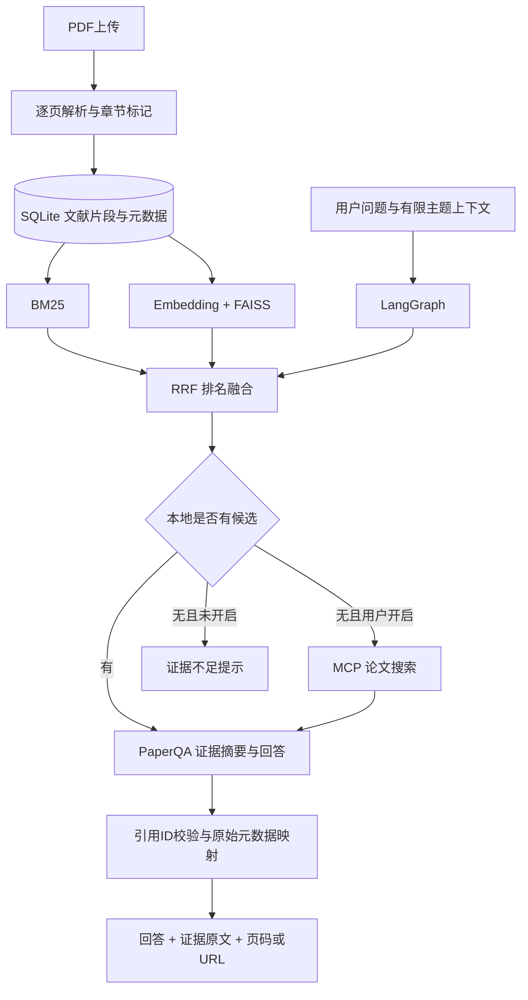

# 架构与面试讲解

## 为什么单独做适配层

PaperQA 5.29.1 的 `Docs.aquery()` 会进行证据与回答处理；本项目仅将混合检索选中的 `Doc/Text` 放入请求级集合，设置 `answer.evidence_retrieval=False`。这样保留其证据摘要与回答流程，同时避免再次执行不受本项目控制的召回。适配层的真实上游集成由 `tests/test_paperqa.py` 验证。

PaperQA 引用的是生成的上下文 ID；适配层将它映射到真实片段，再使用片段的页码与文档 ID。未知上下文 ID 会拒答。这个检查保证来源存在，不证明每个论断都逻辑蕴含于证据；语义忠实性仍需人工或额外评测。

## 文件职责

- `ingest.py`：PDF解析，章节识别，分块，页序与页标签。
- `store.py`：SQLite事务、内容哈希去重、原文及会话存储。
- `embeddings.py`：标准 embeddings HTTP 客户端和可选本地模型。
- `retrieval.py`：分词、BM25、FAISS索引、RRF、持久化校验。
- `paperqa_engine.py`：真实PaperQA证据和回答适配。
- `workflow.py`：有界流程、外部检索开关、最终引用校验。
- `tools.py`：固定配置的MCP工具客户端，不开放任意工具执行。
- `api.py` / `static/index.html`：本地服务与中文交互。

## 已知局限

1. 章节识别是启发式，不保证任意双栏、表格、公式排版；扫描件要求先OCR。
2. 当前切分不跨页，因此页码准确但可能在页边界损失句子连续性。
3. FAISS采用精确内积搜索并归一化为余弦相似度；适合小库，不是大规模ANN系统。
4. RRF分数不是概率，正余弦相似度也不代表证据相关性；PaperQA会进一步处理证据。
5. 外部搜索只有本地未召回时触发，不能自动补救“本地召回但证据不足”的所有问题。
6. 会话历史只提供有限问题上下文，未实现专门的多轮改写模型。
7. 同一会话的并行请求暂不承诺严格对话顺序；不同会话ID的数据分离，但没有多用户权限。
8. 默认单用户、本地使用，不应直接暴露到公网。Docker使用时仅将端口绑定到主机127.0.0.1。

## 可据实际测试讨论的技术难点

- BM25与向量分数不可直接比较：用RRF融合排名，并做同题集比较。
- PDF显示页序与印刷页码不同：同时保存两者，引用明确使用文件页序。
- 模型生成虚构来源：只接受真实上下文ID并映射回解析元数据。
- 上游框架重复检索：请求级候选集合和关闭重复召回，保留真正的PaperQA处理。
- 工具失败及无限执行：固定工具、显式授权、次数限制、超时与图递归上限。

以上是本次代码的设计和验证点，不是对历史实验室部署或历史性能收益的证明。
